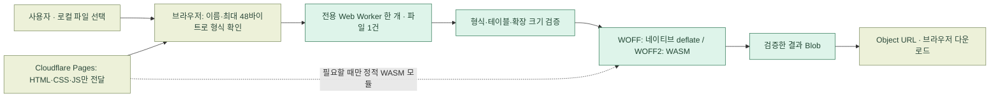

# 설계와 안전 한도

## 데이터 흐름

폼 전송, 백엔드, 서버 함수, 원격 변환, 파일 저장소, 분석 스크립트가 없습니다. 파일 객체는 메모리 내에서 같은 페이지의 작업자에 전달되고, 결과는 Blob을 통해 내려받습니다. 파일이나 변환 결과를 로컬 저장소·IndexedDB에 보관하지 않습니다. 단일 작업자가 끝날 때 종료되어 엔진의 고수위 메모리를 붙들지 않습니다. 변환 데이터 없이 대기 화면에 들어갈 때는 WOFF2 모듈을 로드하지 않습니다.

## 메모리와 중단

- 기기 메모리 정보가 2 GiB 이하이면 입력 6 MiB, 확장 12 MiB, 결과 보관 24 MiB를 쓴다. 미보고 또는 4 GiB 이하에서는 8/20/36 MiB, 그 이상에서는 20/32/64 MiB다. 브라우저가 주는 기기 값은 추정치이지 실제 남은 메모리가 아니다.
- 큐는 최대 12개이며 한 번에 한 파일만 전체를 읽는다. 초기 식별은 48바이트 이하, SFNT와 WOFF는 최대 256테이블을 검사한다. 잘린 헤더·중복/겹침/범위 오류·확장 한도 초과는 변환 시작 전에 가능한 범위에서 거절한다.
- WOFF 압축 해제는 각 테이블의 검증된 길이만큼 미리 확보한 버퍼에 스트리밍한다. 추가로 나오는 데이터는 쓰지 않는다. WOFF2는 선언된 SFNT 크기뿐 아니라 디렉터리의 원본 및 변환 크기 누적값도 제한한 뒤 레퍼런스 WASM 엔진을 부른다.
- 중지는 작업자 자체를 종료하므로 동기 WASM 실행에도 적용된다. 45초를 넘겨도 해당 작업자를 종료하며 다음 파일로 넘어간다. 전체 OS 또는 브라우저의 메모리 부족에 대한 절대 보장은 하지 않는다.
- 진행 단계와 실제 테이블 처리가 가능한 경우 비율을 표시한다. WASM 내부 백분율을 제공하지 않는 단계에는 무한 진행 표시를 사용한다. 파일별 실패는 해당 행에만 남긴다.
- 변환 중 출력 형식은 고정된다. 결과를 제거하면 Object URL을 해제하며, 결과 보관한도 초과 시 저장을 중단한다. 취소한 파일은 명시적으로 다시 대기열에 넣을 수 있다.

## 보존 범위

파일 이름 대신 매직 바이트와 테이블을 검사한다. WOFF 컨테이너를 열 때 필요한 SFNT 체크섬과 검색 경계를 다시 계산한다. 파일을 꺼냈을 때 크기·변환된 형식·윤곽 타입을 재확인한다. 글리프의 CFF와 TrueType 표현식은 서로 다르므로 강제 변환하지 않는다. WOFF2의 정상화, 패딩, 체크섬 수정, 일부 원본 서명과 래퍼 메타데이터에서는 원래 파일의 바이트와 다를 수 있다. 이 검사기는 브라우저 폰트 샌드박스 또는 OpenType 사양 전수 검증을 대체하지 않는다.

## 출처·라이선스

- [W3C WOFF](https://www.w3.org/TR/WOFF/) · [W3C WOFF 2.0](https://www.w3.org/TR/WOFF2/)
- [woff2-encoder](https://github.com/itskyedo/woff2-encoder) · [Google WOFF2 참조 코드](https://github.com/google/woff2) · [Brotli](https://github.com/google/brotli)
- 제3자 고지는 정적 배포물에도 포함한다. UI에는 유료 또는 별도로 수집한 글꼴이 들어가지 않는다. 예시 검증용 시스템 글꼴은 저장소에 재배포하지 않는다.
